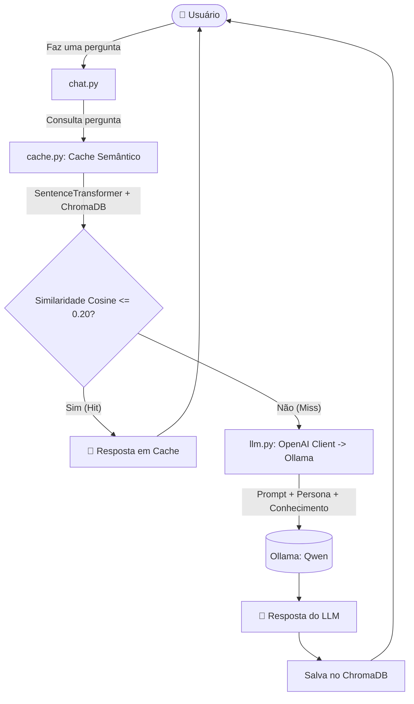

# 🤖 ProgBot - Sistema Especialista em Programação Orientada a Objetos

> 🎓 **Atividade Acadêmica**  
> Projeto desenvolvido para a disciplina **Sistemas Especialistas para Web**  
> **Curso:** Pós-Graduação em Desenvolvimento para Web  
> **Instituição:** Instituto Federal de Educação, Ciência e Tecnologia da Bahia ([IFBA](https://portal.ifba.edu.br/))

---

## 📌 Visão Geral

O **ProgBot** é um agente inteligente e sistema especialista interativo focado no ensino e esclarecimento de dúvidas sobre **Programação Orientada a Objetos (POO)**. 

O sistema integra Modelos de Linguagem de Larga Escala (LLMs) executados localmente através do **Ollama**, utilizando técnicas de engenharia de prompt, definição de personas, injeção de base de conhecimento, restrição de escopo (*guardrails*), **cache semântico vetorial** com embeddings e **avaliação automatizada por juiz LLM (*LLM-as-a-Judge*)**.

---

## 🚀 Principais Funcionalidades

- **Persona Especialista:** Atua estritamente como o tutor *ProgBot*, instruído a responder com precisão sobre os princípios da POO.
- **Restrição de Domínio (*Guardrails*):** Caso receba perguntas fora do escopo de POO, o assistente recusa educadamente o atendimento ("*não posso responder esta pergunta*").
- **Cache Semântico com Embeddings:** Antes de consultar o LLM, o sistema gera embeddings da pergunta do usuário e consulta uma base vetorial no **ChromaDB**. Perguntas semanticamente equivalentes são respondidas instantaneamente pelo cache, reduzindo custo computacional e latência.
- **Base de Conhecimento Estruturada:** Conceitos fundamentais (classes, objetos, herança, polimorfismo, encapsulamento, etc.) são mantidos em formato estruturado (`JSON`).
- **Validação com *LLM-as-a-Judge*:** Um modelo julgador avalia automaticamente se as respostas do assistente atendem aos critérios técnicos e testa a robustez do sistema contra alucinações.
- **Testes Automatizados:** Suíte de testes com `unittest` para validação de assertividade conceitual e filtros de escopo.

---

## 🏗️ Arquitetura do Sistema



---

## 📂 Estrutura de Arquivos

```plaintext
progbot/
│
├── conhecimento/
│   └── poo.json            # Base de conhecimento estruturada com conceitos de POO
│
├── cache/                  # Diretório de persistência do banco vetorial ChromaDB
│
├── cache.py                # Gerenciamento de cache semântico (SentenceTransformer + ChromaDB)
├── chat.py                 # Interface interativa de terminal e ciclo principal do chatbot
├── llm.py                  # Comunicação com o servidor local do Ollama via API OpenAI
├── julgamento.py           # Pipeline de testes com LLM-as-a-Judge e detecção de alucinações
├── teste.py                # Testes de unidade automatizados (unittest)
├── requirements.txt        # Dependências Python do projeto
└── README.md               # Documentação do projeto
```

---

## 🛠️ Tecnologias e Bibliotecas

- **Linguagem:** Python 3.10+
- **Servidor de LLM Local:** [Ollama](https://ollama.com/)
  - Modelo Assistente: `qwen2.5:1.5b` (ou `qwen2.5:3b`)
  - Modelo Julgador: `qwen3:4b`
- **Embeddings & Vetorização:** `sentence-transformers` (`paraphrase-multilingual-MiniLM-L12-v2`)
- **Banco Vetorial:** `chromadb` (armazenamento persistente local com distância de cosseno)
- **Cliente LLM:** `openai` (consumindo endpoint compatível do Ollama)
- **Framework de Testes:** `unittest`

---

## ⚙️ Instalação e Configuração

### 1. Clonar o repositório
```bash
git clone <URL_DO_REPOSITORIO>
cd progbot
```

### 2. Criar e ativar o ambiente virtual (Recomendado)
```bash
# Windows
python -m venv venv
.\venv\Scripts\activate

# Linux / macOS
python3 -m venv venv
source venv/bin/activate
```

### 3. Instalar as dependências
```bash
pip install -r requirements.txt
```

### 4. Instalar e iniciar o Ollama
Certifique-se de que o **Ollama** está instalado e rodando em `http://localhost:11434`. Em seguida, baixe os modelos utilizados:

```bash
ollama pull qwen2.5:1.5b
ollama pull qwen2.5:3b
ollama pull qwen3:4b
```

---

## 💻 Como Utilizar

### 💬 1. Conversar com o ProgBot
Para interagir com o assistente diretamente via terminal:

```bash
python chat.py
```
> O sistema identificará se a resposta foi obtida via **cache vetorial** `[recuperada do cache]` ou gerada pelo modelo `[resposta do llm]`.

### ⚖️ 2. Executar o Julgamento Automatizado (*LLM-as-a-Judge*)
Para executar a rotina de avaliação que valida a precisão técnica das respostas do assistente e testa a rejeição de alucinações:

```bash
python julgamento.py
```

### 🧪 3. Executar os Testes Automatizados
Para rodar os testes unitários de conformidade de respostas e checagem de perguntas proibidas:

```bash
python teste.py
```

---

## 👥 Autoria e Agradecimentos

Projeto acadêmico concebido e implementado como parte dos requisitos de avaliação da disciplina de **Sistemas Especialistas para Web**, pertencente à **Pós-Graduação em Desenvolvimento para Web** do **IFBA (Instituto Federal da Bahia)**.
